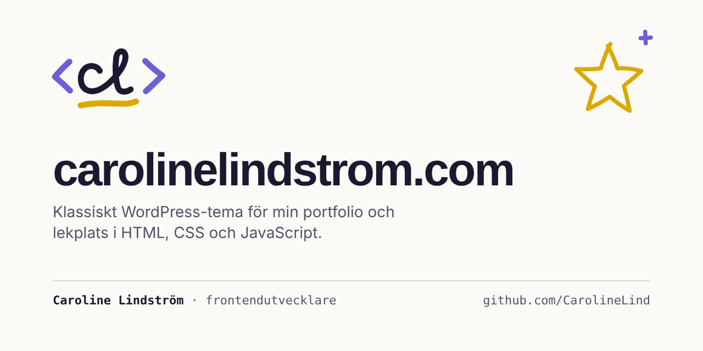

# carolinelindstrom.com



WordPress themes for [carolinelindstrom.com](https://carolinelindstrom.com/), the personal site of Caroline Lindström, frontend developer: a portfolio and a playground in one.

The repo used to be called `laragon`, after the Windows tool the site was first built with. It now runs in [Local](https://localwp.com/) on macOS. The local folder is `GIT-privat/carolinelindstrom.com`.

## What's here

| Folder / file | What it is |
| --- | --- |
| [`carolinelindstrom/`](carolinelindstrom/) | **The new theme**, built on the `new-theme` branch. Start with [its README](carolinelindstrom/README.md). |
| [`CarolineTheme/`](CarolineTheme/) | The old theme that runs the live site today. Being replaced, not maintained. |
| [`docs/decisions/`](docs/decisions/) | Why things are built the way they are, one file per decision |
| [`tools/`](tools/) | Helpers that never go to the server (font trimming, accessibility summary) |
| [`CHECKLIST.md`](CHECKLIST.md) | Everything left to do before the new theme goes live |
| [`CLAUDE.md`](CLAUDE.md) | Rules and working agreements for AI agents (also a good summary for humans) |

## Getting started

Requires [Homebrew](https://brew.sh/), Node.js and the Local app with the site `carolinelindstromcom` set up.

```bash
brew install php composer
composer install
npm install
```

Link the theme into the Local site and activate it under Appearance → Themes: see "Local development" in the [theme README](carolinelindstrom/README.md#local-development).

## Checking your work

```bash
npm run lint
npm run test:a11y:summary
```

`lint` checks PHP and CSS. `test:a11y:summary` runs accessibility tests in light and dark mode against the local site. All commands are described in the [theme README](carolinelindstrom/README.md#quality-checks).

## Quality goals

WCAG 2.2 level AA is the acceptance criterion. Performance, SEO, security and privacy targets are listed in the [theme README](carolinelindstrom/README.md#quality-goals).

## How it's built

I design the site, decide what gets built and how, and review every change. The code is written together with [Claude Code](https://claude.com/claude-code), Anthropic's AI coding assistant, which is why commits carry a `Co-Authored-By: Claude` line.

To keep the result mine and trustworthy rather than just generated:

- **Every change passes the same checks:** WordPress Coding Standards, Stylelint, and automated accessibility tests in light and dark mode. Phones, VoiceOver and zoom are tested by hand.
- **Every trade-off is written down** in [`docs/decisions/`](docs/decisions/): why the fonts are trimmed, why nothing moves before the visitor has chosen, where the header differs from the design.
- **The rules the AI works by are public** in [`CLAUDE.md`](CLAUDE.md), and the routine for each component is in [`.claude/skills/component/`](.claude/skills/component/SKILL.md).

## License

All rights reserved: the code is public to show my work, not for reuse. Third-party fonts, libraries and photos keep their own licenses. See [LICENSE](LICENSE).
